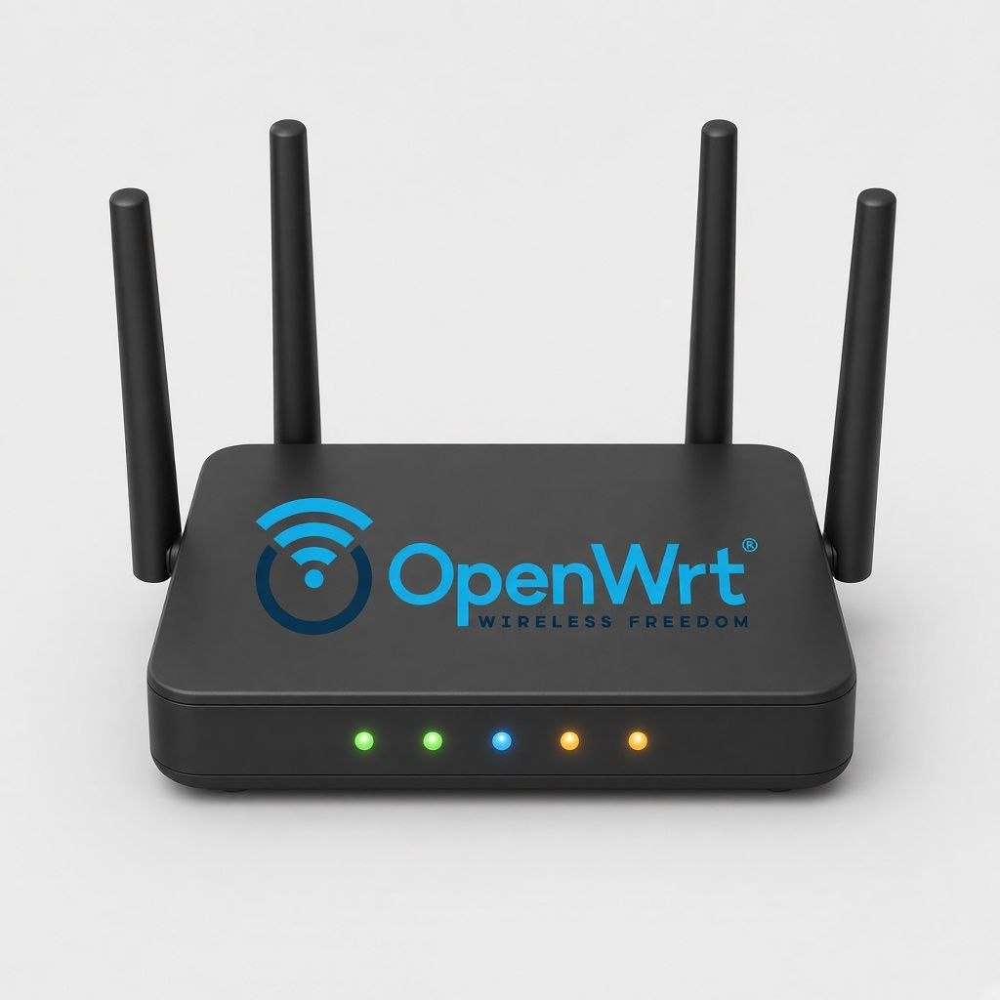

<p align="center">
  
</p>

# OpenWrt LED Control

Небольшое консольное Windows-приложение для управления светодиодными индикаторами роутера на **OpenWrt** по SSH.

Показывает текущее состояние LED и позволяет включать или выключать их по одному либо все сразу.

## Возможности

- Подключение к роутеру по SSH (IP, логин и пароль вводятся при запуске)
- Список индикаторов с состоянием (вкл/выкл) и активным триггером
- Переключение отдельного LED
- Включение всех индикаторов в режиме OpenWrt по умолчанию
- Полное выключение всех индикаторов

Проверено на **Cudy WBR3000UAX v1** (OpenWrt 25.12), но подойдёт и для других устройств OpenWrt с LED в `/sys/class/leds`.

## Быстрый старт

Готовый файл:

```text
publish\LedControl.exe
```

Запустите exe, укажите IP роутера, логин и пароль — откроется меню управления индикаторами.

### Сборка из исходников

Нужен [.NET SDK 10](https://dotnet.microsoft.com/download).

```powershell
dotnet publish -c Release -r win-x64 --self-contained true `
  -p:PublishSingleFile=true `
  -p:IncludeNativeLibrariesForSelfExtract=true `
  -p:EnableCompressionInSingleFile=true `
  -o publish
```

## Управление

| Команда | Действие |
|--------|----------|
| `1`…`N` | Переключить выбранный LED |
| `on N` / `off N` | Включить / выключить LED №N |
| `a` | Включить все (режим OpenWrt по умолчанию) |
| `x` | Выключить все |
| `r` | Обновить список |
| `q` | Выход |

## Требования

- Windows x64
- Роутер с OpenWrt и включённым SSH
- Учётная запись с доступом к `/sys/class/leds` (обычно `root`)

## Как это работает

Приложение подключается по SSH и управляет LED через sysfs OpenWrt:

- чтение `/sys/class/leds/*/brightness` и `trigger`
- выключение: `trigger=none`, `brightness=0`
- включение: восстановление типичных триггеров устройства
- массовые операции: `/etc/init.d/led turnoff` / `turnon`

## Лицензия

MIT
